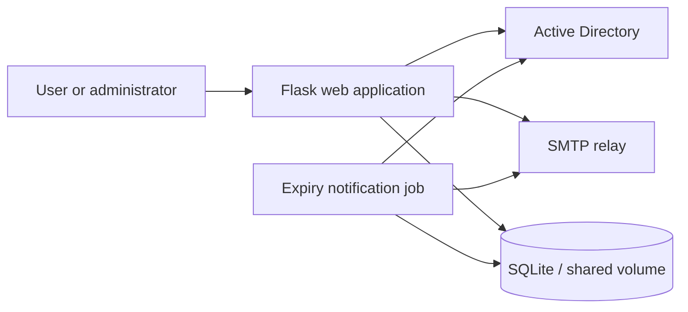

# PassAD

Self-hosted Active Directory password management with single-use password-change links, password-expiry notifications, an administrator interface, and Docker deployment.

PassAD is intended for IT administrators operating on-premises Active Directory. Users follow an emailed link and provide their current password to change it. Administrators can view directory users, send notifications, and review email, password-change, and activity records.

## Current scope

This repository contains a Flask application configured for **one AD domain per deployment**, with SQLite storage and a separate cron container. It does not currently contain the later multi-domain/PostgreSQL implementation. Features in the [proposed roadmap](docs/ROADMAP.md) are not promises about the current release.

- Random, time-limited tokens; generating a new token invalidates the user's previous unused tokens.
- Password changes using the user's current AD credentials.
- Configurable password-expiry notification window and token lifetime.
- An administrator dashboard, user list, email logs, password logs, and activity logs.
- Administrator-initiated password resets for expired accounts using the configured service account.
- A shared Docker volume for token and log databases.

This is a self-hosted project, not a hosted password service. Review the configuration and current implementation before connecting it to a production directory.

## Architecture



| Component | Implementation |
|---|---|
| Web | Python 3.10 Docker image, Flask, Jinja templates |
| Directory integration | ldap3 |
| Data | SQLite token and log databases |
| Background job | A separate Docker container running cron |
| Delivery | SMTP relay and HTML email templates |

## Getting started

Prerequisites: Docker with a Compose command, an accessible AD test domain, an SMTP relay, and a service account with the directory permissions required for the actions you enable.

```bash
git clone https://github.com/burak-aras/passAD.git
cd passAD
cp .env.example .env
```

Edit `.env` before starting the containers. Use your own values; generate a random `SECRET_KEY` and set an administrator password. Start with a dedicated test account and an explicitly configured `TEST_RECIPIENT`.

| Variable | Purpose |
|---|---|
| `AD_SERVER` | Directory server hostname or address |
| `AD_DOMAIN` | AD domain used for user authentication |
| `AD_BASE_DN` | Search base, for example `DC=example,DC=local` |
| `AD_USER`, `AD_PASSWORD` | Directory service account credentials |
| `SECRET_KEY` | Flask session signing secret |
| `ADMIN_PASSWORD` | Administrator panel password |
| `SMTP_SERVER`, `SMTP_PORT` | Reachable SMTP relay |
| `SENDER_EMAIL` | Notification sender |
| `PASSAD_URL` | User-accessible application URL used in email links |
| `WARNING_START`, `WARNING_END` | Inclusive minimum and maximum whole days until expiry |
| `TOKEN_VALIDITY_HOURS` | Lifetime of a password-change link |
| `TEST_RECIPIENT` | Optional override recipient for outgoing emails |

For notifications from zero through seven days before expiry, set `WARNING_START=0` and `WARNING_END=7`. The example environment currently uses a wider range; choose it deliberately.

The checked-in Compose file sets `AD_USE_SSL=False` for the web service. Setting only a value in `.env` does not override that literal. Review `docker-compose.yml` together with the directory connection code when configuring LDAP transport. Password modifications use LDAPS or StartTLS according to the service configuration.

Build and start the application:

```bash
docker compose up -d --build
docker compose ps
```

If your environment uses the standalone Compose executable, replace `docker compose` with `docker-compose`.

The checked-in configuration exposes HTTP on host port 80. For a local test, open `http://localhost/admin/`. Users reach the password-change page through their emailed token link. Configure HTTPS and appropriate access controls before production use; the image currently starts Flask's built-in server.

## Notifications and administrator actions

The schedule in [`jobs/crontab`](jobs/crontab) runs at **09:00 on Mondays**, with `TZ=Europe/Istanbul` configured for the job container. A narrow warning window may require a more frequent schedule. If you change the cron file, rebuild the job image.

```bash
docker compose logs -f passad-web password-expiry-job
```

To execute the notification job manually, after checking the recipient and test directory configuration:

```bash
docker compose run --rm --entrypoint python3 password-expiry-job jobs/password_expiry_job.py
```

`TEST_RECIPIENT` changes the email recipient only. It is **not a dry-run mode** and does not disable AD password modifications. In the current administrator flow, sending an email for an expired account can first reset that account's password using the service account.

The notification job skips accounts without a usable email address and excludes disabled accounts and accounts marked as having non-expiring passwords. Check AD attributes and logs when investigating a missing notification.

## Data and operational boundaries

- Preserve the `token-storage` Docker volume. `docker compose down -v` deletes the stored token and log databases.
- Keep `.env`, database backups, reset links, directory exports, and credentials out of Git and public issue reports.
- The current SMTP service uses a relay without an application-configured SMTP authentication or STARTTLS flow.
- This revision has no checked-in automated test suite or CI workflow. Tests for a later implementation should not be presented as coverage for this revision.
- HTTP health checks establish that the web endpoint responds; they are not an end-to-end AD/SMTP check.

## Contributing

Bug reports, reproducible test cases, documentation improvements, and focused pull requests are welcome. See [CONTRIBUTING.md](CONTRIBUTING.md) for the workflow and [the roadmap](docs/ROADMAP.md) for proposed work. English and Turkish contributions are welcome.

For sensitive security reports, use GitHub private vulnerability reporting if it is enabled. Do not publish credentials, live reset tokens, or affected users' details in an issue. No separate private security contact or response-time commitment is documented at present.

## License

[MIT](LICENSE). Third-party dependencies retain their respective licenses.
