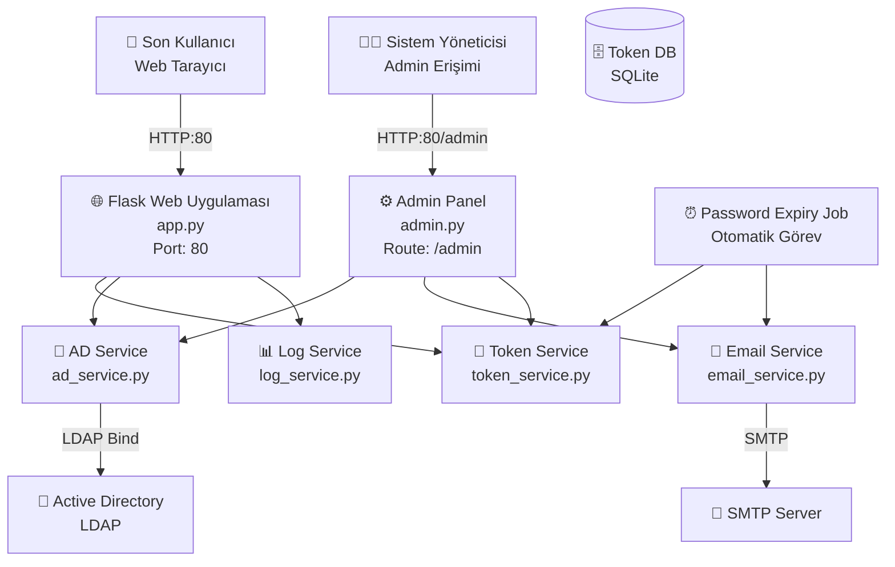
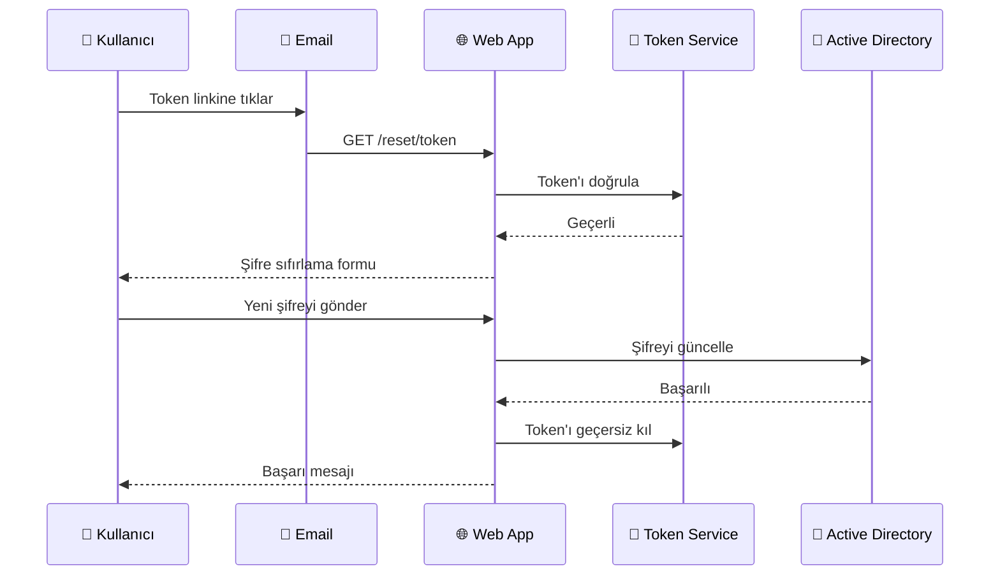
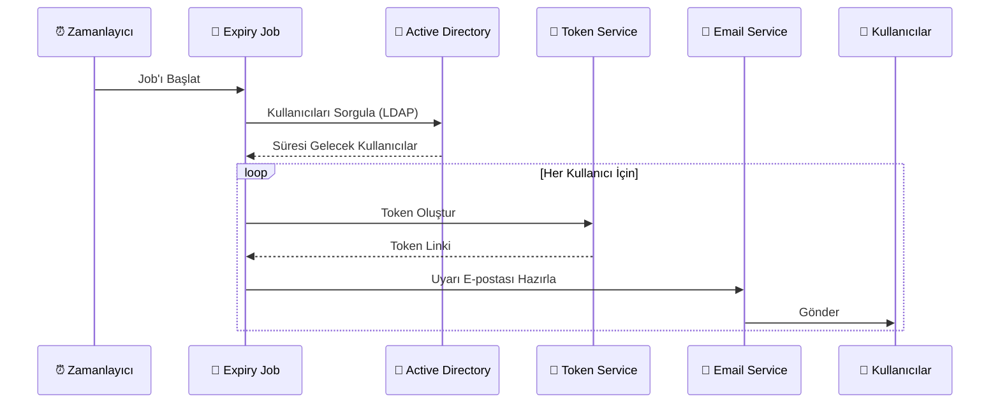

# 🔐 PassAD: Active Directory Self-Service Password Reset


PassAD, Active Directory kullanıcılarının kendi şifrelerini güvenli bir şekilde sıfırlamalarını sağlayan, Docker tabanlı modern bir web uygulamasıdır. Sistem ayrıca, şifre süresi dolmak üzere olan kullanıcılara otomatik e-posta bildirimleri göndererek proaktif şifre yönetimini destekler.

---

## 🌟 Özellikler

- **🔑 Token Tabanlı Sıfırlama:** Kullanıcılara özel, tek kullanımlık ve zaman ayarlı (24 saat) güvenli bağlantılar gönderilir.
- **📧 Otomatik Bildirimler:** Şifre süresi dolmak üzere olan (örn. son 7 gün) kullanıcılar otomatik tespit edilir ve uyarılır.
- **🛡️ Güvenli Mimari:** Flask tabanlı backend, LDAP entegrasyonu ve izole Docker servisleri.
- **🐳 Dockerize:** Kolay kurulum ve yönetim için tam Docker desteği.
- **📱 Modern Arayüz:** Responsive tasarım ile tüm cihazlarda kusursuz deneyim.
- **⚙️ Admin Paneli:** Manuel e-posta gönderimi ve sistem takibi için yönetim arayüzü.

---

## 🏗️ Sistem Mimarisi ve Topoloji

Sistemin çalışma mantığı ve bileşenleri aşağıda detaylandırılmıştır.

### 1. Genel Sistem Mimarisi
Sistem; Web Arayüzü, Arka Plan Servisleri, Active Directory ve SMTP sunucusu arasındaki etkileşimi yönetir.



### 2. Şifre Sıfırlama Akışı
Kullanıcının e-posta bildirimi aldıktan sonraki şifre sıfırlama süreci.



### 3. Otomatik Uyarı Sistemi (Cron Job)
Sistemin belirli aralıklarla çalışarak şifresi dolacak kullanıcıları tespit etmesi.



---

## 🚀 Kurulum ve Başlangıç

Bu proje Docker ve Docker Compose kullanılarak kolayca kurulabilir.

### Ön Gereksinimler
- Docker & Docker Compose
- Active Directory / LDAP Sunucusu
- SMTP Sunucusu (E-posta gönderimi için)

### Adım 1: Kurulum
Projeyi sunucunuza klonlayın ve dizine gidin:
```bash
git clone https://github.com/yourusername/passad.git
cd passad
```

### Adım 2: Konfigürasyon (.env)
Örnek `.env.example` dosyasını `.env` olarak kopyalayın ve içeriğini kendi ortamınıza göre düzenleyin. 
**Not:** Bu dosya hassas bilgiler (şifreler vb.) içerir, bu nedenle `.gitignore` dosyasına eklenmiştir ve versiyon kontrolüne (git) **eklenmemelidir**.

```bash
cp .env.example .env
nano .env
```

Aşağıdaki tabloda `.env` dosyasındaki tüm ayarların ne işe yaradığı detaylıca açıklanmıştır:

| Kategori | Değişken | Açıklama | Örnek |
|----------|----------|----------|-------|
| **Active Directory** | `AD_SERVER` | AD sunucusunun IP adresi veya hostname'i. | `192.168.1.50` |
| | `AD_DOMAIN` | Domain adı (Domain Controller'daki domain). | `example.local` |
| | `AD_BASE_DN` | LDAP sorguları için Base DN (Distinguished Name). | `DC=example,DC=local` |
| | `AD_USER` | AD üzerinde okuma/yazma yetkisi olan servis hesabı (Domain\User formatında). | `EXAMPLE\svc_passad` |
| | `AD_PASSWORD` | Servis hesabının şifresi. | `GizliSifre123!` |
| **SMTP (E-posta)** | `SMTP_SERVER` | E-posta gönderimi için kullanılacak SMTP sunucusu. | `172.20.34.51` |
| | `SMTP_PORT` | SMTP portu (Genellikle 25 veya 587). | `25` |
| | `SENDER_EMAIL` | Gönderen olarak görünecek e-posta adresi. | `noreply@example.com` |
| **Uygulama** | `PASSAD_URL` | Uygulamanın yayınlandığı URL (E-posta linklerinde kullanılır). | `http://passad.example.com` |
| | `SECRET_KEY` | Flask oturum güvenliği için rastgele, uzun bir anahtar. | `rastgele-uzun-bir-guvenlik-anahtari` |
| | `ADMIN_PASSWORD` | `/admin` paneline erişim için kullanılacak şifre. | `admin123` |
| **Zamanlayıcı (Job)** | `WARNING_START` | Şifre süresinin dolmasına kaç gün kala uyarı gönderilmeye başlansın? | `14` (Son 14 gün kala başlar) |
| | `WARNING_END` | Şifre süresinin dolmasına kaç gün kala uyarı gönderimi dursun? | `0` (Süre dolana kadar gönderir) |
| | `TOKEN_VALIDITY_HOURS` | Şifre sıfırlama linkinin geçerlilik süresi (saat). | `24` |
| **Test Modu** | `TEST_RECIPIENT` | **Sadece Test İçin:** Eğer tanımlıysa, sistem TÜM e-postaları gerçek kullanıcılar yerine bu adrese gönderir. Prodüksiyonda boş bırakın. | `admin@example.com` |

> **İpucu:** Eğer Docker kullanıyorsanız ve ortam değişkenlerini `docker-compose.yml` içinden yönetmek isterseniz, `.env` dosyasındaki değerleri oraya da taşıyabilirsiniz, ancak `.env` dosyası kullanımı daha temiz ve güvenli bir yöntemdir.

### Adım 3: Çalıştırma
Container'ları ayağa kaldırın:
```bash
docker-compose up -d
```

Web arayüzüne `http://localhost` veya sunucu IP adresinizden erişebilirsiniz.

---

## 🛠️ Kullanım ve Yönetim

### Manuel Job Çalıştırma
Otomatik kontrolü beklemeden e-posta gönderimini tetiklemek için:
```bash
docker-compose run --rm password-expiry-job
```

### Logları İzleme
Sistem durumunu kontrol etmek için:
```bash
docker-compose logs -f
```

### Admin Paneli
Yönetim paneline `/admin` yolundan erişilebilir (Erişim kısıtlamalarını yapılandırdığınızdan emin olun).

---

## 🔒 Güvenlik Notları
- **HTTPS:** Prodüksiyon ortamında mutlaka SSL/TLS (Nginx Reverse Proxy vb.) kullanın.
- **Gizlilik:** `.env` dosyanızı ve veritabanı dosyalarınızı (`data/*.db`) koruyun.
- **Erişim:** Admin paneline erişimi IP bazlı kısıtlamanız önerilir.

---

## 🐛 Sorun Giderme
Eğer "invalid credentials" hatası alıyorsanız:
1. AD servis hesabı şifresinin doğru olduğundan emin olun.
2. AD hesabının kilitli olmadığını kontrol edin.
3. LDAP bağlantı portlarının (389/636) açık olduğunu doğrulayın.

---

**PassAD** - [Your Company](https://example.com)
Versiyon 1.2
